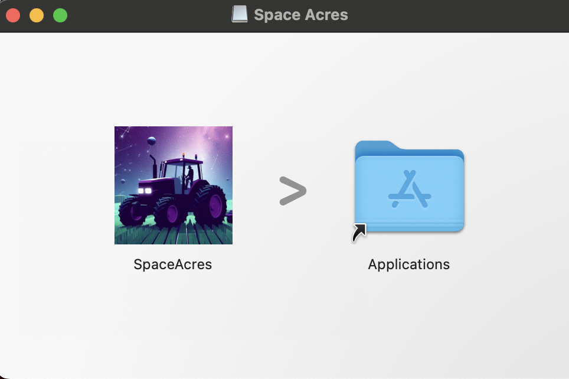

import ReleaseButton from '@site/src/components/ReleaseButton';
import ReleaseContainer from '@site/src/components/ReleaseContainer';

:::caution Minimum macOS Version

Space Acres requires macOS 26 (Tahoe) or newer on Apple Silicon. Older macOS versions and Intel Macs are not supported.

:::

### Download the Space Acres Installer
<ReleaseContainer>
    <ReleaseButton to="https://github.com/autonomys/space-acres/releases/download/0.2.24/space-acres-0.2.24.dmg" title="macOS Installer" subtitle="(.dmg)" />
</ReleaseContainer>

### Install Space Acres

1. Open the downloaded Space Acres installer by double-clicking it. 
2. Drag Space Acres into your Applications folder.
    
    
    
3. Launch the application upon successful installation. 

